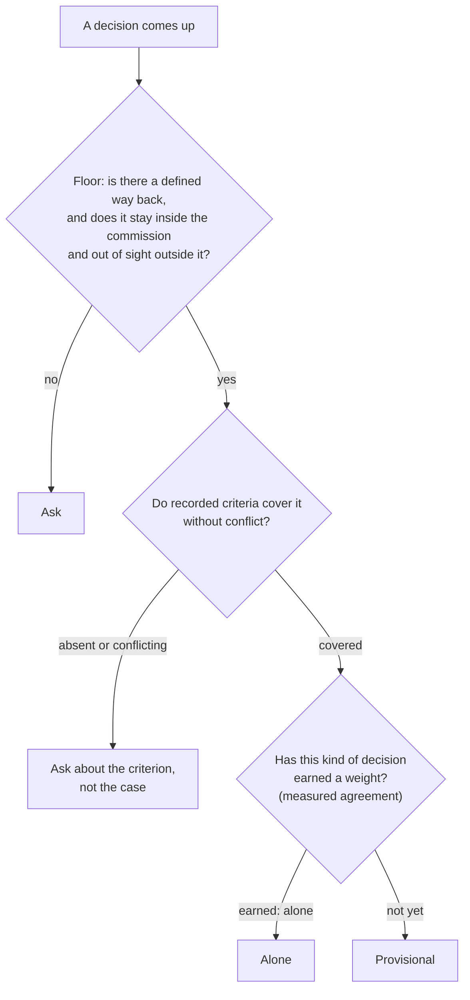
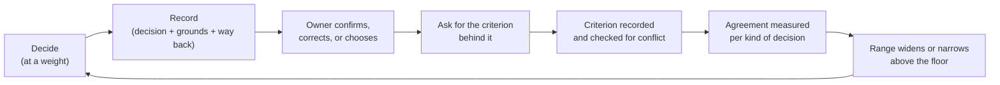

# The method

> Status: **draft, reviewed and approved by the owner as the starting design.** Principles marked *settled* were decided outright; the points under [Decisions](#decisions-starting-positions) are approved as **starting positions** to be tuned against real corrections. There is no code yet — this document is the design the code will follow.

## The question this answers

An owner delegates work to an agent. The agent will meet decisions the owner never listed in advance. **Which of them may it settle alone, which must it bring back, and how does that line move as the two come to understand each other?**

LegateAI is the layer that answers this, in the same way every time, for any agent in any product. It owns the **form** of a decision: how a decision is weighed, how a question is put, how the reasons are recorded, how criteria are kept consistent. It does not own *what* any criterion says (that belongs to whoever adopts the method), and it does not measure how far an agent can be trusted (that evidence is read through a [port](#the-trust-port)).

## Three weights

*Settled: three weights, a fixed floor, and a range above it that is earned.* The names below are provisional.

| Weight | The agent… | The owner… | Record kept |
|---|---|---|---|
| **Alone** | decides and acts; tells the owner afterwards | may glance at it; a sample may be re-judged without the agent's answer | decision + way back |
| **Provisional** | acts on its own recommendation, having laid the options out | corrects or confirms later; a correction is a signal | decision + options + grounds + way back + "to correct" line |
| **Ask** | lays out options, each with grounds and trade-offs, and recommends one; does **not** act | chooses | decision + options + the choice |

- **The floor never moves.** A decision with no defined way back, or one that is visible outside the commission, is always asked — however well the agent has done before. Trust widens the range *above* the floor; it does not lower it.
- **"A way back" must be named.** "It could probably be undone" is not a way back.
- **The middle weight exists because corrections are the loop's fuel.** If everything the agent acts on is either invisible or asked beforehand, the owner has nowhere to correct it.

## Criteria

A **criterion** is a statement the owner has made — or an owner choice that was turned into one — that settles a class of decision. Criteria are the thing the method keeps in order.

- **Absent or conflicting criteria are why a recommendation cannot be made.** The agent then asks about the *criterion* ("which should weigh more, and when?"), not about the surface case. Asking about the case produces one answer; asking about the criterion produces a rule.
- **When the owner picks something other than the recommendation,** the agent asks which criterion weighed differently — *revise it, or is this a one-off exception?* — and records the answer either way, so a one-off is not later read as precedent.
- **Conflicts are detected, not left to drift.** Recorded criteria and recorded decision flows are checked against each other; where they disagree, the agent asks the owner to align them, so the set converges.
- **Precedence is part of a criterion's record** (a narrower scope beats a wider one; a later statement beats an earlier one unless marked an exception). Without it, conflict detection has nothing to decide with.

## Records

Three records; their exact fields are an open decision, their *roles* are not.

| Record | Role |
|---|---|
| **Decision** | what was decided, at which weight, on which options and grounds, under which criteria (by version), with which way back, and by whom (agent or owner) |
| **Criterion** | the statement, the kind of decision it covers, where it came from (owner statement, or derived from an override), its precedence, its status (active, revised, exception) |
| **Recheck** | a decision that was drawn for blind re-judgment: the draw's probability, recorded *before* anyone re-judged; the second judgment; whether they agreed |

A decision is never recorded without the criteria it relied on. *A decision without its grounds should not be expressible.*

## The loop

*Settled: the owner's corrections become criteria, and measured agreement — not elapsed time or confidence — is what widens the range.*

A narrow range at the start is not a defect; it is the starting state. Each turn of the loop should make the next ask rarer and better aimed. If the range never widens, the criteria are not converging and that is itself a finding.

## The trust port

LegateAI needs one thing it will not produce: **evidence of agreement between the agent's judgment and the owner's, by kind of decision.** It reads that through a port.

- The port is **defined here**; whoever measures implements it. This repository depends on no measurement system, and a measurement system may itself use this method without a cycle.
- What flows through the port: for a kind of decision, the number of comparisons, the agreement among them, how recent they are, and how they were drawn (so the odds can be weighed). What does not: the content of any decision.
- The kind of measurement it expects is a **blind recheck with recorded odds** — a share of the decisions the agent settled is drawn deterministically, the draw's probability recorded first, and re-judged by the owner without seeing the agent's answer. Anything that can supply comparisons of that quality can implement the port.

## What LegateAI does not do

- It does not measure trust (above).
- It does not carry any organization's rules. A criterion's *content* is data supplied by the adopter.
- It does not draw the screens. How an owner is shown options is the adopting product's work; LegateAI defines what a question must contain.
- It does not decide on the agent's behalf what its tools may do; it decides how the agent decides *whether* to act.

## Decisions (starting positions)

Each is approved as the position to start from. Numbers 1, 2, 3 and 6 are expected to change once there is measured data; 4, 5, 7 and 8 stand until real use shows a reason.

1. **The first threshold.** How much measured agreement, over how many comparisons, lets a kind of decision move from Provisional to Alone? *Recommend:* start with a high bar and a minimum sample, expressed as configuration rather than constants, and tune on real corrections.
2. **How agreement is measured.** Blind recheck of Alone decisions is the model; its burden on the owner needs a bound. *Recommend:* a fixed small draw rate that falls as agreement is shown and rises on disagreement, with the rate always recorded.
3. **Does trust narrow?** If the owner corrects an Alone decision, does the kind drop back a weight at once, or after a second disagreement? *Recommend:* drop at once for one weight, and ask for the criterion.
4. **The name and border of the middle weight.** "Provisional" is a placeholder. *Recommend:* keep the line "acted on, correctable, with the way back written" as its definition.
5. **What a "kind of decision" is.** The unit across which agreement is counted. Too fine and nothing accumulates; too coarse and a good record in easy cases licenses a hard one. *Recommend:* kinds are declared by the adopter, with the floor applied regardless.
6. **Shape of the port.** The fields above are a sketch. *Recommend:* settle it against one real measurement system before freezing it.
7. **How it is built in.** Agents that would embed this are written in different languages and run in different processes. *Recommend:* keep the record shapes as a language-neutral specification with a reference implementation, rather than one library.
8. **Precedence rules for criteria.** The two rules above (narrower beats wider, later beats earlier unless excepted) are a starting point. *Recommend:* test them on real conflicting criteria before extending.
